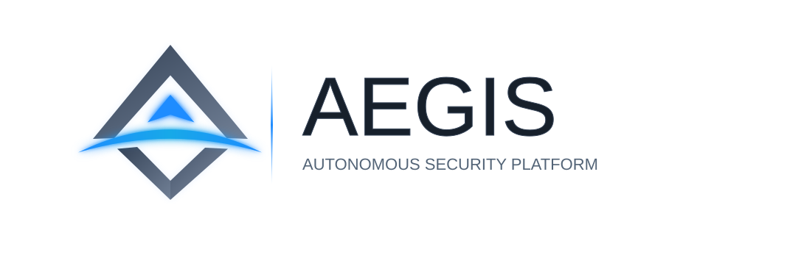
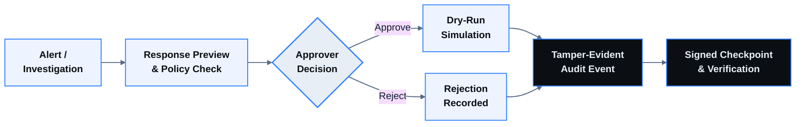
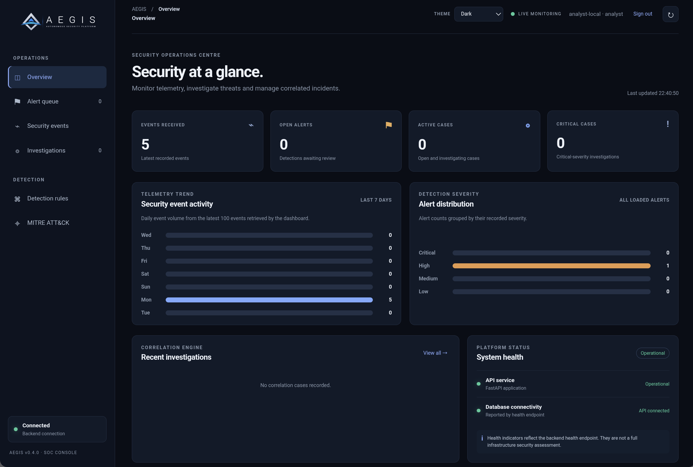
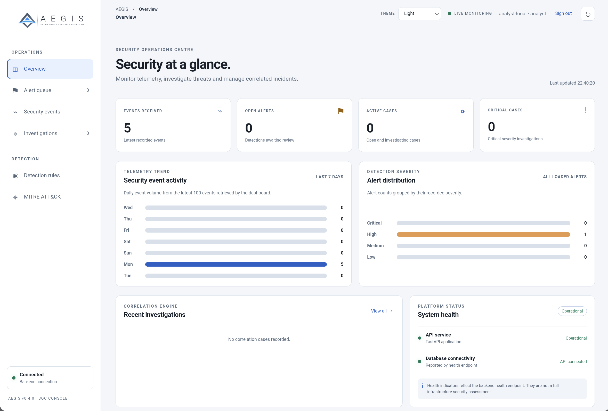
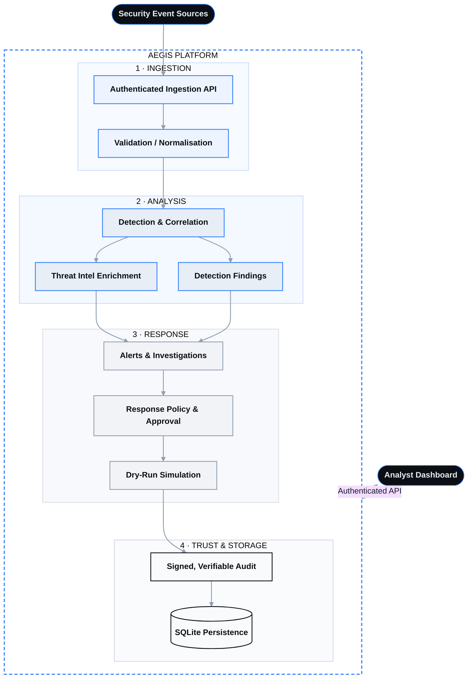

<div align="center">

<h1 align="center" id="aegis-security-platform">
  <picture>
    <source
      media="(prefers-color-scheme: dark)"
      srcset="docs/assets/aegis-sentinel-dark.svg"
    />
    <source
      media="(prefers-color-scheme: light)"
      srcset="docs/assets/aegis-sentinel-light.svg"
    />
    
  </picture>
</h1>

### Autonomous Threat Detection • Intelligence • Controlled Response

**Engineered for visibility. Built for investigation. Designed for controlled response.**

*From raw security telemetry to actionable, auditable security decisions.*

<br/>

<!-- =========================
     CORE STATUS
========================= -->
<p>

<a href="https://github.com/Nomusa990822/aegis-security-platform/actions/workflows/backend-tests.yml">

</a>


</p>

<!-- =========================
     TECH STACK
========================= -->
<p>


</p>

<!-- =========================
     SECURITY CAPABILITIES
========================= -->
<p>


</p>

<!-- =========================
     GITHUB META
========================= -->
<p>


</p>

<br/>

[**Overview**](#overview) · [**Capabilities**](#core-capabilities) · [**Architecture**](#system-architecture) · [**Quality**](#quality--verification) · [**Quick Start**](#quick-start) · [**Docker Demo**](#docker-compose-demo-deployment) · [**Limitations**](#security-scope--current-limitations)

</div>

---

## Table of Contents

- [Overview](#overview)
- [At a Glance](#at-a-glance)
- [Core Capabilities](#core-capabilities)
- [System Architecture](#system-architecture)
- [Quality & Verification](#quality--verification)
- [Technical Documentation](#technical-documentation)
- [Quick Start](#quick-start)
- [Run AEGIS Locally](#run-aegis-locally)
- [Docker Compose Demo Deployment](#docker-compose-demo-deployment)
- [Security Scope & Current Limitations](#security-scope--current-limitations)
- [Next Engineering Milestones](#next-engineering-milestones)
- [What AEGIS Demonstrates](#what-aegis-demonstrates)

---

## Overview

AEGIS is a **modular, API-driven security operations platform** built to demonstrate core workflows found in modern security monitoring and incident response systems.

It brings together event ingestion, detection engineering, alert investigation, threat-intelligence enrichment, MITRE ATT&CK context, and a controlled response workflow backed by tamper-evident audit evidence.

AEGIS is designed as a hands-on cybersecurity engineering project: the emphasis is not only on identifying suspicious activity, but also on preserving the reasoning, decisions, and evidence behind an investigation.

> [!IMPORTANT]
> **Project classification: portfolio-grade engineering prototype.** AEGIS is not a production SIEM, EDR, XDR, identity provider, or managed security service. Response execution is simulated; no real firewall or host-level changes are made.

---

## At a Glance

| | |
|---|---|
| **Detection** | 10 registered rules across authentication and network activity |
| **Context** | Curated MITRE ATT&CK catalogue of 10 technique and sub-technique entries |
| **Intelligence** | External IP reputation enrichment with failure isolation |
| **Response** | Policy-gated approval workflow with dry-run simulation only |
| **Integrity** | Tamper-evident audit events with signed, verifiable checkpoints |
| **Telemetry** | Authenticated API ingestion plus Linux OpenSSH and Nginx log adapters |
| **Interface** | Browser-based analyst dashboard served at `/dashboard` |
| **Verification** | Automated backend regression suite run through GitHub Actions |

---

## Core Capabilities

### 1. Security Telemetry Ingestion

A structured API entry point for security events, with a lightweight log adapter.

- Authenticated event submission
- Strict request validation and normalisation
- External event identity and duplicate handling
- Linux OpenSSH authentication-log parsing
- Nginx combined access-log parsing
- Deterministic per-file-line event identities for safe replay
- Dry-run parsing before submission
- Request-body size enforcement and transaction-safe persistence

### 2. Detection Engineering

A modular detection engine evaluates incoming telemetry against registered rules.

| Rule ID | Category | Detection capability |
|---|---|---|
| `AEGIS-AUTH-001` | Authentication | Brute-force authentication |
| `AEGIS-AUTH-002` | Authentication | Password spraying |
| `AEGIS-AUTH-003` | Authentication | Distributed password guessing across source IPs |
| `AEGIS-AUTH-004` | Authentication | Successful authentication after repeated failures |
| `AEGIS-AUTH-005` | Authentication | Successful authentication to one account from multiple source IPs |
| `AEGIS-NET-001` | Network | Network port scanning |
| `AEGIS-NET-002` | Network | Horizontal network scanning |
| `AEGIS-NET-003` | Network | Broad network service discovery |
| `AEGIS-NET-004` | Network | Suspicious network beaconing |
| `AEGIS-NET-005` | Network | Remote-service connection fan-out across common administration ports |

Detection logic includes threshold and time-window handling, with adversarial and regression tests for boundary conditions, duplicate telemetry, noisy activity, and overlapping patterns.

### 3. Alert Management & Investigation

Detections can become actionable investigation records.

- Alert lifecycle and status management
- Analyst notes and evidence linking
- Investigation timelines
- Related-event context
- Audit history
- Correlation of related alerts into cases

### 4. Threat Intelligence & Risk Assessment

AEGIS enriches supported public IP assessments using its threat-intelligence provider integration.

- External IP reputation enrichment
- Provider failure isolation and timeout handling
- Persisted enrichment assessments
- Risk scoring and confidence context
- Intelligence context available to investigations

> [!NOTE]
> Provider results depend on external service availability, configuration, and API limits.

### 5. MITRE ATT&CK Context

Detection rules are associated with a curated MITRE ATT&CK catalogue of **10 technique and sub-technique entries**:

| Technique | Name |
|---|---|
| `T1110` | Brute Force |
| `T1110.001` | Password Guessing |
| `T1110.003` | Password Spraying |
| `T1078` | Valid Accounts |
| `T1021` | Remote Services |
| `T1046` | Network Service Discovery |
| `T1071` | Application Layer Protocol |
| `T1071.001` | Web Protocols |
| `T1595` | Active Scanning |
| `T1595.001` | Scanning IP Blocks |

This is a deliberately limited subset, not full ATT&CK coverage. Technique associations provide analytical context; they do not independently prove that a technique occurred.

### 6. Controlled Response Workflow

A guarded response lifecycle designed around policy and accountability.

- Response previews and policy checks
- Analyst / approver role separation
- Approval and rejection decisions
- Dry-run response simulation
- Tamper-evident response audit events
- Signed audit checkpoints and integrity verification
- Checkpoint quarantine and recovery safeguards



> [!WARNING]
> The `BLOCK_IP` action is a workflow capability only. AEGIS does not apply real firewall rules or execute operating-system containment commands.

### 7. API Security & Access Control

- Bearer-token authentication
- Analyst and approver role boundaries
- Strict API request schemas
- Constant-time token comparison
- Request-body limits
- API rate limiting
- Health checks and database availability reporting

Authentication currently uses environment-configured static role tokens. MFA, OTP, SSO, and full user lifecycle management are not implemented.

### 8. Analyst Dashboard

A browser-based interface for interacting with AEGIS through its authenticated API.

- Served from the backend at `/dashboard`
- Analyst authentication
- Security operations and investigation workflows
- API-backed data rather than hardcoded actor identities

#### Dashboard Screenshots

The screenshots below show the actual AEGIS Overview dashboard captured during a local demonstration. They are presented as captured, in both supported themes.

**Dark theme**



**Light theme**



The captured demonstration snapshot shows five security events received, one high-severity alert, no active or critical cases, and healthy API and database status. These are point-in-time values from this demonstration environment, not benchmark results or claims about detection effectiveness.


---

## System Architecture

AEGIS is organised as a modular security workflow. Events enter through an authenticated API, are validated and analysed, and any resulting response is gated by policy, simulated, and recorded in a signed audit trail.



### Engineering Principles

1. **Evidence before action**: response workflows are gated by policy and approval.
2. **Integrity is part of the workflow**: audit evidence is verified before sensitive response operations.
3. **Failure must be contained**: provider failures and database errors should not silently become successful outcomes.
4. **Security controls need regression tests**: concurrency, malformed input, tampering, and authorisation boundaries are tested.
5. **Be explicit about limitations**: prototype capabilities are not presented as production guarantees.

---

## Quality & Verification

The backend includes regression coverage for:

- Authentication and role-based authorisation
- Strict input validation and request-size limits
- API rate limiting
- Duplicate event handling and ingestion atomicity
- Detection thresholds and adversarial cases
- Threat-intelligence enrichment failures
- Concurrent database and response operations
- Audit-chain and signed-checkpoint integrity
- Checkpoint recovery and quarantine behaviour
- End-to-end API workflows

The complete backend test suite can be run locally with:

```bash
cd backend
python -m pytest -q
```

Automated regression tests are configured through GitHub Actions: [Backend Tests Workflow](https://github.com/Nomusa990822/aegis-security-platform/actions/workflows/backend-tests.yml).

> [!NOTE]
> A passing test suite demonstrates the tested behaviours. It is not a substitute for an independent penetration test, formal security audit, or real-world detection evaluation.

---

## Technical Documentation

| Resource | Description |
|---|---|
| [`README.md`](README.md) | Project overview, setup, capabilities, and limitations |
| [`TESTING_STATUS.md`](TESTING_STATUS.md) | Regression test batches and verification status |
| [`docs/security/AUDIT_CHECKPOINT_KEY_ROTATION.md`](docs/security/AUDIT_CHECKPOINT_KEY_ROTATION.md) | Audit checkpoint signing-key rotation guidance |
| [`backend/app/telemetry/cli.py`](backend/app/telemetry/cli.py) | Linux SSH and Nginx log import command |

---

## Quick Start

The fastest way to see AEGIS running is the [Docker Compose demo](#docker-compose-demo-deployment):

```bash
git clone https://github.com/Nomusa990822/aegis-security-platform.git
cd aegis-security-platform

# Create a private .env first (see "Docker Compose Demo Deployment" below)
docker compose up --build -d
```

Then open the dashboard at <http://localhost:8000/dashboard>. To run from source instead, follow [Run AEGIS Locally](#run-aegis-locally).

---

## Run AEGIS Locally

### Requirements

- Python 3.14
- Git

### 1. Clone the repository

```bash
git clone https://github.com/Nomusa990822/aegis-security-platform.git
cd aegis-security-platform/backend
```

### 2. Create the environment

```bash
python -m venv .venv
source .venv/bin/activate
python -m pip install --upgrade pip
pip install -r requirements.txt
```

On Windows PowerShell:

```powershell
.venv\Scripts\Activate.ps1
```

### 3. Configure credentials

AEGIS requires separate analyst and approver tokens, plus a signing key for response audit checkpoints. Generate unique secrets locally:

```bash
export AEGIS_ANALYST_TOKEN="$(openssl rand -hex 32)"
export AEGIS_APPROVER_TOKEN="$(openssl rand -hex 32)"
export AEGIS_ANALYST_ID="analyst-local"
export AEGIS_APPROVER_ID="approver-local"

export AEGIS_AUDIT_CHECKPOINT_KEY="$(openssl rand -hex 32)"
export AEGIS_AUDIT_CHECKPOINT_KEY_ID="local-v1"
export AEGIS_AUDIT_CHECKPOINT_DIR="$PWD/audit_checkpoints"
```

> [!CAUTION]
> Keep these values private and out of source control. Preserve the signing key and key ID when you need to verify checkpoints from an earlier run.

Optional threat-intelligence provider configuration:

```bash
export ABUSEIPDB_API_KEY="your-provider-api-key"
```

### 4. Start the application

From the `backend/` directory:

```bash
uvicorn app.main:app --reload
```

### 5. Import representative security logs

From the `backend/` directory, configure an analyst token and preview a log before ingestion:

```bash
read -rsp "AEGIS analyst token: " AEGIS_ANALYST_TOKEN
export AEGIS_ANALYST_TOKEN
printf '\n'

python -m app.telemetry.cli /path/to/auth.log --format sshd --dry-run
python -m app.telemetry.cli /var/log/nginx/access.log --format nginx --dry-run
```

Submit parsed events through the existing authenticated API:

```bash
python -m app.telemetry.cli /path/to/auth.log --format sshd --year 2026
python -m app.telemetry.cli /var/log/nginx/access.log --format nginx
```

The importer uses the existing API URL by default (`http://127.0.0.1:8000/api/v1/events`). Override it with `AEGIS_API_URL` or `--api-url`. Supply `AEGIS_ANALYST_TOKEN` in the environment; never place tokens in command-line arguments or source control. The importer reports unsupported lines as ignored. SSH syslog timestamps have no year or timezone, so the adapter assumes UTC and the current year unless `--year` is supplied. The event API normalises timezone-aware `occurred_at` values to UTC; naive timestamps are interpreted as UTC.

| Service | Local URL |
|---|---|
| Analyst Dashboard | <http://127.0.0.1:8000/dashboard> |
| API Health | <http://127.0.0.1:8000/api/v1/health> |
| Interactive API Docs | <http://127.0.0.1:8000/docs> |

The local SQLite database is created under `backend/aegis.db`.

---

## Docker Compose Demo Deployment

The repository includes a single-container Docker Compose deployment for a reproducible local demonstration. It persists the SQLite database and signed response-audit checkpoints in a named Docker volume.

### Requirements

- Docker Engine
- Docker Compose v2

### 1. Create local credentials

From the repository root, generate a private environment file once:

```bash
cat > .env <<EOF
AEGIS_ANALYST_TOKEN=$(openssl rand -hex 32)
AEGIS_APPROVER_TOKEN=$(openssl rand -hex 32)
AEGIS_ANALYST_ID=analyst-local
AEGIS_APPROVER_ID=approver-local
AEGIS_AUDIT_CHECKPOINT_KEY=$(openssl rand -hex 32)
AEGIS_AUDIT_CHECKPOINT_KEY_ID=local-v1
AEGIS_AUDIT_CHECKPOINT_DIR=/data/audit_checkpoints
AEGIS_DATABASE_PATH=/data/aegis.db
EOF
```

> [!CAUTION]
> Keep `.env` private and preserve it between restarts: changing the checkpoint signing key can prevent verification of checkpoints signed with the previous key. Do not commit the file or paste its contents into issue trackers.

### 2. Build and start AEGIS

```bash
docker compose up --build -d
docker compose ps
```

### 3. Open the services

| Service | URL |
|---|---|
| Analyst Dashboard | <http://localhost:8000/dashboard> |
| API Health | <http://localhost:8000/api/v1/health> |
| Interactive API Docs | <http://localhost:8000/docs> |

Use the analyst token from your local `.env` file when the dashboard requests authentication. Keep the approver token separate for approval-only operations.

### 4. Stop and restart

```bash
docker compose down
docker compose up -d
```

The named `aegis-data` volume survives `docker compose down`.

> [!WARNING]
> **Do not use `docker compose down -v`** unless you intentionally want to delete the persisted database and audit checkpoints. Back up the volume and retain the matching signing credentials.

This Compose configuration is for a local, single-container demonstration. It does not make SQLite or the process-local rate limiter suitable for multi-worker or public production deployment. Do not expose the service directly to the public internet.

---

## Security Scope & Current Limitations

AEGIS focuses on a defined set of security operations workflows. It does not attempt to claim complete enterprise security coverage.

| Area | Current position |
|---|---|
| Authentication | Static environment-configured analyst and approver tokens |
| MFA / OTP | Not implemented |
| SSO / OAuth / OIDC / SAML | Not implemented |
| Detection | Ten registered rules |
| MITRE ATT&CK | Curated ten-entry subset |
| Telemetry collection | API-based event submission; no endpoint agent |
| Packet inspection | Not implemented |
| Syslog / Sysmon collectors | Not implemented |
| Threat intelligence | Configurable external provider integration |
| Response | Approval workflow and simulation only |
| Rate limiting | Process-local; not shared across multiple workers |
| Database | SQLite for local and single-process use |
| Malware sandbox / EDR | Not implemented |

### Deployment Considerations

SQLite is suitable for local development and a single-process demonstration. A multi-worker or production deployment would require a shared database such as PostgreSQL, shared rate limiting, managed secrets, hardened identity/session handling, backups, monitoring, and a reviewed deployment architecture.

Do not expose the development server directly to the public internet.

---

## Next Engineering Milestones

The core detection, investigation, threat-intelligence, MITRE-context, controlled-response, and Linux SSH/Nginx telemetry-adapter workflows are implemented and covered by the current regression suite. Remaining work should focus on making the prototype easier to demonstrate and operate:

1. Improve the dashboard's visibility into detection evidence, MITRE mappings, and any unmapped detection rules.
2. Prepare a reproducible demonstration deployment with persistent storage, managed secrets, backups, and explicit single-process constraints.
3. Evaluate PostgreSQL and shared rate limiting only when moving beyond the local, single-process prototype.

MFA and stronger identity management remain a separate security milestone. Large endpoint agents, malware sandboxes, full ATT&CK ingestion, unsupported machine-learning claims, and real automated containment remain outside the current low-cost prototype scope.

---

## What AEGIS Demonstrates

- Security event pipeline design
- Detection engineering and adversarial testing
- API authentication and authorisation
- Threat-intelligence enrichment
- Incident investigation workflows
- MITRE ATT&CK contextual mapping
- Controlled response and approval design
- Audit integrity, signed checkpoints, and recovery
- Concurrency and database reliability engineering
- Automated backend regression testing

---

<div align="center">

**AEGIS — Autonomous Threat Detection and Response Platform**

*Observe. Detect. Investigate. Verify.*

<sub>[Back to top](#aegis-security-platform)</sub>

</div>
