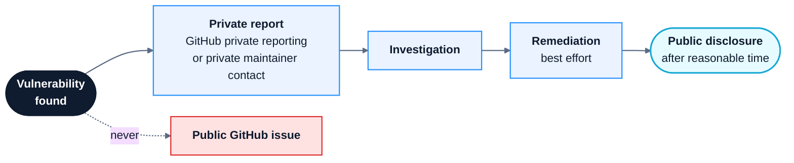
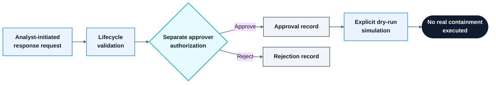

# Security Policy

  
  
  

**Quick links:** [Report a vulnerability](#reporting-a-vulnerability) · [Supported versions](#supported-versions) · [Security controls](#implemented-security-controls) · [Deployment guidance](#deployment-and-configuration) · [Known limitations](#known-limitations)

---

## Contents

- [Project Status](#project-status)
- [Supported Versions](#supported-versions)
- [Reporting a Vulnerability](#reporting-a-vulnerability)
- [Implemented Security Controls](#implemented-security-controls)
- [Deployment and Configuration](#deployment-and-configuration)
- [Known Limitations](#known-limitations)
- [Security Testing](#security-testing)
- [Responsible Use](#responsible-use)

---

## Project Status

AEGIS Security Platform is an educational and portfolio-grade cybersecurity engineering prototype. It demonstrates security monitoring, threat detection, investigation, threat-intelligence enrichment, audit integrity, and controlled response workflows.

> [!IMPORTANT]
> AEGIS is **not a production-hardened SIEM, EDR, or XDR platform**. It has not been represented as independently penetration-tested, security-certified, or suitable for deployment in environments requiring production-grade security guarantees.
>
> Do not rely on AEGIS as the sole security control protecting systems, networks, or sensitive information.

---

## Supported Versions

Security fixes are intended for the latest version on the repository's `main` branch. No formal long-term support or release-maintenance guarantees are currently provided.

| Version | Security support |
|---|---|
| Latest `main` | Best-effort security fixes |
| Older commits | Not actively maintained |
| Unreleased development versions | No support guarantee |

---

## Reporting a Vulnerability

> [!CAUTION]
> Please **do not** disclose exploitable vulnerabilities, credentials, tokens, personal information, or sensitive proof-of-concept material in public GitHub issues.

### How to report

1. **Use GitHub's private vulnerability reporting.** If it is enabled for this repository, use the **Report a vulnerability** feature.
2. **Otherwise, contact the maintainer privately** through an available GitHub contact channel.

### What a useful report includes

- A concise description of the vulnerability
- The affected component, endpoint, or file
- The conditions required to reproduce the issue
- The potential security impact
- Relevant logs or a minimal proof of concept, with secrets and personal information removed
- Any suggested mitigation, if known

### Reporting process

Please allow reasonable time for investigation and remediation before publicly disclosing an unresolved vulnerability.

> [!NOTE]
> There is currently no guaranteed response or remediation service-level agreement.

---

## Implemented Security Controls

### Authentication and authorization

| Control | Detail |
|---|---|
| **Bearer-token authentication** | API authentication uses HTTP Bearer tokens |
| **Separate credentials** | Analyst and approver credentials are configured separately |
| **Minimum token length** | Both credentials must be at least 32 characters long |
| **Distinct tokens** | The application rejects identical analyst and approver tokens |
| **Distinct identities** | Analyst and approver identities must also be distinct |
| **Constant-time comparison** | Credential comparisons use `hmac.compare_digest` |
| **Role enforcement** | Role-specific dependencies restrict analyst and approver operations |

These mechanisms provide application-level role separation. They do not replace a full identity-management platform.

### Request protection

| Control | Detail |
|---|---|
| **Request-size validation** | Implemented through request middleware |
| **API rate limiting** | Implemented for event ingestion |
| **Rate-limit identity** | Ingestion limits use both bearer-token fingerprints and client IP addresses |
| **Token fingerprinting** | Fingerprints are generated with SHA-256, so raw bearer tokens are not retained as rate-limit identities |

> [!NOTE]
> Rate limiting and client IP identification depend on the deployment environment. Reverse proxies and forwarded client addresses must be configured and trusted carefully.

### Audit integrity

The response audit subsystem includes:

- Cryptographically linked audit events
- Audit-chain consistency verification
- HMAC-signed audit checkpoints
- Checkpoint key identifiers and support for previous signing keys
- Checkpoint validation and recovery safeguards

These mechanisms help detect certain forms of audit-record alteration and inconsistency. They do **not** guarantee tamper-proof storage. An attacker with sufficient control over the application, database, checkpoint files, and signing keys may be able to compromise the integrity evidence.

For stronger assurance, signing keys and checkpoint copies should be protected independently from the application host.

### Controlled response

The response workflow implements:

- Analyst-initiated response requests
- Separate approver authorization
- Approval and rejection records
- Response lifecycle validation
- Explicit dry-run simulation

> [!WARNING]
> **AEGIS does not execute real endpoint containment or operating-system response commands.** Its response workflow is a controlled simulation, not an automated containment system.

---

## Deployment and Configuration

### Secrets

Create a local `.env` file using `.env.example` as the template. Before running the application:

- [ ] Replace all placeholder credentials with unique, randomly generated secrets
- [ ] Use separate analyst and approver tokens
- [ ] Configure a strong audit checkpoint signing key
- [ ] Keep `.env` private and outside version control
- [ ] Never publish tokens, signing keys, API keys, or database credentials
- [ ] Rotate credentials if they are exposed or suspected to be compromised

The example configuration is not intended to provide production secrets.

### Docker deployment

The supplied Docker configuration includes several container-hardening measures:

| Measure | Purpose |
|---|---|
| Dedicated non-root application user | Avoids running the application as root |
| Read-only container root filesystem | Limits writes inside the container |
| Temporary filesystem for `/tmp` | Provides scratch space without a writable root |
| Dropped Linux capabilities | Removes unneeded kernel privileges |
| `no-new-privileges` | Prevents privilege escalation inside the container |
| Persistent storage | Keeps application data and audit checkpoints |
| Container health check | Reports service health |

These measures reduce certain container risks but do not independently secure the host, Docker daemon, network, persistent volumes, or deployment environment.

> [!CAUTION]
> The Compose configuration publishes the application on port `8000`. Restrict network access appropriately. Do not expose an unauthenticated or unprotected development deployment to the public internet.

### Data protection

The application uses SQLite and persistent storage for its database and audit checkpoints. Operators are responsible for:

- Protecting database and checkpoint files
- Restricting filesystem permissions
- Maintaining secure backups
- Protecting backup copies and signing keys
- Testing recovery procedures
- Avoiding the inclusion of sensitive information in demonstration data

Do not use real production credentials or sensitive operational data in demonstrations.

---

## Known Limitations

The project should be evaluated with the following limitations in mind:

| Area | Limitation |
|---|---|
| **Identity** | Authentication uses configured Bearer tokens rather than a complete identity-management system |
| **MFA / federation** | Multi-factor authentication and enterprise identity federation are not currently provided |
| **Role separation** | It does not establish independent human identities when credentials are shared |
| **Storage** | SQLite and local checkpoint storage are not substitutes for independently administered security infrastructure |
| **Audit integrity** | The mechanisms cannot protect against every compromise of the application host or signing-key environment |
| **Rate limiting** | It and deployment security depend partly on network and infrastructure configuration |
| **Response** | Dry-run simulation does not provide real containment |
| **Testing** | Automated tests do not establish the absence of security vulnerabilities |

---

## Security Testing

The repository includes automated regression tests for application functionality and security-related behaviour.

**Documented test baseline: 10 November 2026**

| Passed | Failed | Skipped | Warnings |
|:---:|:---:|:---:|:---:|
| **702** | **0** | **0** | **0** |

> [!NOTE]
> The test suite is intended to detect regressions in implemented behaviour. It is not a substitute for independent penetration testing, threat modelling, code auditing, or deployment-specific security assessments.

---

## Responsible Use

Use AEGIS only on systems, networks, and data for which you have appropriate authorization. Do not use the platform to conduct unauthorized monitoring, access, disruption, or testing.

Contributions that improve security, reliability, validation, audit integrity, and defensive capabilities are welcome.
