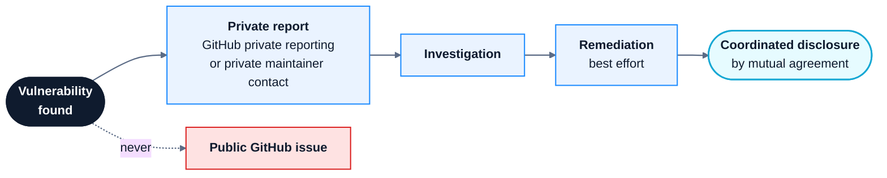

# Security Policy

<p align="center">
  
  
  <a href="https://github.com/Nomusa990822/aegis-security-platform/actions/workflows/backend-tests.yml">
    
  </a>
</p>

**Quick links:** [Report a vulnerability](#reporting-a-vulnerability) · [Supported versions](#supported-versions) · [Security controls](#implemented-security-controls) · [Deployment guidance](#deployment-and-configuration) · [Known limitations](#known-limitations)

---

## Contents

- [Project Status](#project-status)
- [Supported Versions](#supported-versions)
- [Reporting a Vulnerability](#reporting-a-vulnerability)
- [Implemented Security Controls](#implemented-security-controls)
- [Deployment and Configuration](#deployment-and-configuration)
- [Known Limitations](#known-limitations)
- [Security Testing](#security-testing)
- [Responsible Use](#responsible-use)

---

## Project Status

AEGIS Security Platform is an educational and portfolio-grade cybersecurity engineering prototype. It demonstrates security monitoring, threat detection, investigation, threat-intelligence enrichment, audit integrity, and controlled response workflows.

> [!IMPORTANT]
> AEGIS is **not a production-hardened SIEM, EDR, or XDR platform**. It has not been represented as independently penetration-tested, security-certified, or suitable for deployment in environments requiring production-grade security guarantees.
>
> Do not rely on AEGIS as the sole security control protecting systems, networks, or sensitive information.

---

## Supported Versions

Security fixes are intended for the latest version on the repository's `main` branch. No formal long-term support or release-maintenance guarantees are currently provided.

| Version | Security support |
|---|---|
| Latest `main` | Best-effort security fixes |
| Older commits | Not actively maintained |
| Unreleased development versions | No support guarantee |

---

## Reporting a Vulnerability

> [!CAUTION]
> Please **do not** disclose exploitable vulnerabilities, credentials, tokens, personal information, or sensitive proof-of-concept material in public GitHub issues.

### How to report

Use GitHub's **Private vulnerability reporting** feature to
confidentially report security vulnerabilities.

<p align="center">
  <a href="https://github.com/Nomusa990822/aegis-security-platform/security/advisories/new">
    
  </a>
</p>

The report will be submitted privately through GitHub Security Advisories.

If private reporting is unavailable, contact the repository
maintainer through a private GitHub communication channel.

Do not disclose vulnerability details through public issues,
pull requests, discussions, or other public channels.

### What a useful report includes

- A concise description of the vulnerability
- The affected component, endpoint, or file
- The conditions required to reproduce the issue
- The potential security impact
- Relevant logs or a minimal proof of concept, with secrets and
  personal information removed
- Any suggested mitigation, if known

### Acknowledgement and remediation

Reports will be reviewed on a best-effort basis.

Where appropriate, the maintainer will investigate the report,
assess its impact, and work towards a corrective change.

There is currently no guaranteed acknowledgement, response,
or remediation timeframe.

Security researchers are encouraged to coordinate disclosure
with the maintainer before publicly disclosing an unresolved
vulnerability.

### Reporting process



Please coordinate public disclosure with the maintainer. The timing and approach should be agreed between the researcher and maintainer; no fixed disclosure or remediation timeline is guaranteed.

> [!NOTE]
> There is currently no guaranteed response or remediation service-level agreement.

---

## Implemented Security Controls

The security controls documented below are implemented in the
application codebase. The following source files provide direct
implementation references.

| Security area | Implementation |
|---|---|
| Authentication and authorization | [`backend/app/auth.py`](backend/app/auth.py) |
| Request-size validation | [`backend/app/request_limits.py`](backend/app/request_limits.py) |
| API rate limiting | [`backend/app/rate_limiting.py`](backend/app/rate_limiting.py) |
| Audit-chain hashing and verification | [`backend/app/response/audit_chain.py`](backend/app/response/audit_chain.py) |
| Audit-chain storage | [`backend/app/response/audit_chain_storage.py`](backend/app/response/audit_chain_storage.py) |
| Audit checkpoint integrity | [`backend/app/response/audit_checkpoint.py`](backend/app/response/audit_checkpoint.py) |
| Audit integrity inspection endpoint | [`backend/app/response/audit_router.py`](backend/app/response/audit_router.py) |
| Response audit validation | [`backend/app/response/audit.py`](backend/app/response/audit.py) |
| Response authorization policy | [`backend/app/response/policy.py`](backend/app/response/policy.py) |

### Authentication and authorization

| Control | Detail |
|---|---|
| **Bearer-token authentication** | Protected API routes use HTTP Bearer credentials; public health and root endpoints are not authenticated |
| **Separate credentials** | Analyst and approver credentials are configured separately |
| **Minimum token length** | Both configured tokens must contain at least 32 characters after surrounding whitespace is stripped |
| **Distinct tokens** | The application rejects identical analyst and approver tokens |
| **Distinct identities** | Analyst and approver identities must also be distinct |
| **Constant-time comparison** | Credential comparisons use `hmac.compare_digest` |
| **Role enforcement** | Role-specific dependencies restrict analyst and approver operations |

These mechanisms provide application-level role separation. They do not replace a full identity-management platform.

### Request protection

| Control | Detail |
|---|---|
| **Request-size validation** | Middleware rejects request bodies larger than 1 MiB, including chunked bodies, before passing the buffered body to application handlers |
| **General API limit** | API routes under `/api/v1/` are limited to 300 requests per 60-second window by client connection address, excluding the health endpoint and the separately limited authentication endpoint |
| **Authentication endpoint limit** | `/api/v1/auth/me` is limited to 20 requests per 60-second window by client connection address |
| **Event-ingestion limits** | `POST /api/v1/events` is limited to 120 requests per 60-second window per bearer-token fingerprint and 240 requests per 60-second window per client connection address |
| **Token fingerprinting** | Bearer tokens are SHA-256 fingerprinted for rate-limit keys; raw tokens are not stored as rate-limit identities |
| **Counter scope** | Rate-limit counters are held in process memory and are not shared between multiple worker processes or application instances |

> [!NOTE]
> Client addresses are taken from the ASGI connection scope. Forwarded headers such as `X-Forwarded-For` are deliberately ignored; trusted-proxy address resolution is not implemented. When deployed behind a reverse proxy, requests may therefore be grouped under the proxy's connection address.

### Audit integrity

The response audit subsystem includes:

- A SHA-256 hash chain that links each audit event to the preceding event
- Audit-chain verification of event ordering, hash linkage, and event contents
- Comparison of the verified chain against its stored event count and final hash
- HMAC-SHA-256-signed audit checkpoints
- Checkpoint key identifiers and support for configured previous signing keys
- Checkpoint validation before an existing checkpoint is advanced
- Per-response file locking and atomic checkpoint-file replacement during writes
- An audit-integrity inspection endpoint protected by approver-role authorization

These mechanisms help detect certain forms of audit-record alteration and inconsistency. They do **not** guarantee tamper-proof storage. An attacker with sufficient control over the application, database, checkpoint files, and signing keys may be able to compromise the integrity evidence.

For stronger assurance, signing keys and checkpoint copies should be protected independently from the application host.

### Controlled response

The response workflow implements:


- Analyst-initiated response requests
- Separate approver authorization
- Approval and rejection records
- Response lifecycle validation
- Explicit dry-run simulation

> [!WARNING]
> **AEGIS does not execute real endpoint containment or operating-system response commands.** Its response workflow is a controlled simulation, not an automated containment system.

---

## Deployment and Configuration

### Secrets

Create a local `.env` file using `.env.example` as the template. Before running the application:

- [ ] Replace the analyst and approver token placeholders with separate, randomly generated secrets of at least 32 characters
- [ ] Keep the analyst and approver tokens different
- [ ] Set distinct analyst and approver actor IDs
- [ ] Configure an audit checkpoint signing key of at least 32 characters
- [ ] Keep the checkpoint signing key separate from the bearer tokens
- [ ] Keep `.env` private and outside version control
- [ ] Never publish tokens, signing keys, API keys, or database credentials
- [ ] Rotate credentials if they are exposed or suspected to be compromised

Restrict local access to the environment file, for example with `chmod 600 .env` on Linux. Do not paste its contents into issues, logs, screenshots, or support requests.

The example configuration is not intended to provide production secrets.

### Docker deployment

The supplied Docker configuration includes several container-hardening measures:

| Measure | Purpose |
|---|---|
| Dedicated non-root application user | Avoids running the application as root |
| Read-only container root filesystem | Limits writes inside the container |
| Temporary filesystem for `/tmp` | Provides scratch space without a writable root |
| Dropped Linux capabilities | Removes unneeded kernel privileges |
| `no-new-privileges` | Prevents privilege escalation inside the container |
| Persistent storage | Keeps application data and audit checkpoints |
| Container health check | Reports service health |

These measures reduce certain container risks but do not independently secure the host, Docker daemon, network, persistent volumes, or deployment environment.

> [!CAUTION]
> The current Compose mapping, `8000:8000`, publishes the application on the host's network interfaces by default. For local-only access, change it to `127.0.0.1:8000:8000`. If remote access is required, place the service behind a properly configured reverse proxy or gateway, enforce TLS there, and restrict inbound network access. The application container does not itself provide HTTPS termination.
>
> Do not expose an unauthenticated or unprotected development deployment to the public internet. Also note that the current rate limiter deliberately ignores forwarded headers; behind a proxy, requests may be grouped under the proxy's connection address until trusted-proxy handling is implemented.

### Data protection

The Compose configuration mounts a named Docker volume at `/data`, where the SQLite database and audit checkpoint directory are configured to persist. The container's read-only root filesystem does not make this mounted volume read-only.

Operators are responsible for:

- Protecting database and checkpoint files in the persistent volume
- Restricting filesystem permissions on host-side data and backup locations
- Maintaining secure backups
- Protecting backup copies and signing keys independently of the application host
- Testing recovery procedures
- Avoiding the inclusion of sensitive information in demonstration data

Do not use real production credentials or sensitive operational data in demonstrations.

---

## Known Limitations

AEGIS is an evolving cybersecurity engineering prototype. The following
limitations describe the current implementation and should be considered
before deployment or security evaluation.

| Area | Current limitation |
|---|---|
| Authentication model | Response authentication uses two configured static Bearer tokens. OAuth 2.0, OpenID Connect, SSO, MFA, an external identity provider, and user or session lifecycle management are not implemented. |
| Human identity assurance | Separate analyst and approver tokens and actor IDs enforce application roles, but do not independently establish that different people are using them. Credential sharing remains possible. |
| Rate limiting | Rate-limit counters are held in process memory. They reset when the application process restarts and are not shared across multiple workers, containers, or replicas. |
| Reverse-proxy deployment | Client IP addresses are taken from the ASGI connection scope. Forwarded headers are deliberately ignored; behind a reverse proxy, requests may therefore be grouped under the proxy's address. Trusted-proxy handling is not implemented. |
| Database architecture | SQLite is used for persistent application data. A distributed database, high-availability configuration, and multi-instance coordination are not implemented. |
| Audit storage and trust boundary | Audit events, chain-head records, and signed checkpoints are stored on the application-managed data volume. Checkpoints are not independently administered or anchored in external immutable/WORM storage. |
| Audit integrity | The SHA-256 event chain, chain-head comparison, and HMAC-signed checkpoints provide integrity checks and tamper evidence. They cannot guarantee detection if an attacker can compromise or rewrite the database, checkpoint files, and relevant signing keys together. |
| Response execution | Response actions are restricted to dry-run simulation. AEGIS does not currently block traffic, isolate endpoints, terminate processes, or execute operating-system containment commands. |
| Transport security | The application does not terminate HTTPS itself. Production network exposure requires a separately configured TLS-terminating reverse proxy or gateway and appropriate network restrictions. |
| Security assurance | Automated tests and CI checks validate expected behavior; they do not establish that the platform is vulnerability-free. No independent penetration test, formal security certification, or production security assessment is claimed. |

These limitations define the current scope of the project. Deployment
controls and successful automated tests must not be interpreted as a
guarantee that AEGIS is secure or suitable for production use.

## Security Testing

AEGIS has an automated backend regression suite. It checks expected
application behaviour, including implemented security-related controls
and response workflows. The suite is useful for detecting regressions;
it is not a comprehensive security assessment.

### Continuous integration

Third-party GitHub Actions used by the CI workflows are pinned to full
commit SHAs rather than mutable major-version tags. Version comments are
retained beside the pins for readability. This reduces the risk that a
tag is moved to different action code without a corresponding reviewed
repository change. Pinning does not replace reviewing action updates,
their maintainers, permissions, or transitive dependencies.

The backend suite runs through GitHub Actions on:

- Push events
- Pull requests
- Manual workflow dispatches

The workflow uses an Ubuntu runner and Python 3.14, installs the pinned
dependency snapshot in `backend/requirements.lock`, runs `pip-audit`
against the installed environment, and executes:

```bash
python -m pytest -q
```

**[View Backend Tests Workflow](https://github.com/Nomusa990822/aegis-security-platform/actions/workflows/backend-tests.yml)**

### Recorded test baseline

**Recorded execution: 10 November 2026**

[View the recorded GitHub Actions run](https://github.com/Nomusa990822/aegis-security-platform/actions/runs/42789706062)

| Metric | Result |
|---|---:|
| Tests passed | 702 |
| Tests failed | 0 |
| Tests skipped | 0 |
| Pytest warnings | 0 |
| Test execution time | 20.22 seconds |
| Workflow result | Success |

This is a dated result from one successful CI execution. It is not a
live test count, does not guarantee that later commits pass, and should
not be presented as proof that the platform is secure.

### Dependency update automation

Dependabot version-update checks are configured weekly for the Python
dependencies in `/backend` and the GitHub Actions used by this repository.
Dependabot may open pull requests when newer compatible dependency or
action versions are available.

Version-update pull requests are not the same as vulnerability alerts
or a dependency vulnerability scan. GitHub Dependabot alerts and security
updates depend on repository security settings and should be enabled and
reviewed separately.

`backend/requirements.txt` remains the human-maintained direct dependency
input. `backend/requirements.lock` records exact versions for the resolved
Python dependency set and is used by CI and the Docker build. The
`.github/scripts/verify_requirements_lock.py` check rejects non-exact lock
entries, duplicate normalized package names, and direct requirements that
are absent from the lockfile. CI then installs from the lockfile and runs
`pip check` to verify that the installed distributions have compatible
declared dependencies.

The current lock snapshot pins versions but does not include package hashes,
so installation is **not hash-verified** and this validation does not prove
the identity of downloaded package files. When changing dependencies,
update the input and regenerate/review the complete lock snapshot in a clean
Python 3.14 environment. Updates must be reviewed and tested before
merging; do not treat an automatically opened update pull request as
approved for release.

### Python dependency vulnerability auditing

The backend CI workflow installs `pip-audit` and runs it against the
installed Python environment after installing `backend/requirements.lock`.
The audit checks installed distributions against known vulnerability
advisories available to the tool. A reported vulnerability causes the
workflow step to fail and should be investigated before merging or
releasing.

This check is not a substitute for hash-verified dependency installation,
software composition analysis across every artifact, container image
scanning, or review of vulnerabilities that have not yet been disclosed
or added to the advisory data sources. The auditor itself is installed
during CI and is not currently pinned to a fixed version.

### Container software bill of materials (SBOM)

The container security workflow generates a CycloneDX JSON software bill
of materials from the same Docker image that is scanned by Trivy. Before
uploading it, CI validates that the file is non-empty valid JSON, declares
the CycloneDX format and a specification version, and contains named,
typed top-level components with no duplicate component `bom-ref` values.
The workflow writes a concise component-count summary to the GitHub Actions
run summary, then uploads the file as the `aegis-container-sbom` artifact
and retains it for 30 days. The artifact can be downloaded from a successful
container security workflow run to inspect the package inventory.

The SBOM is a build-specific inventory, not proof that every component
is vulnerability-free or that the image is safe. It describes the image
built by that workflow run; rebuilds may produce a different inventory
as upstream base-image packages and dependency sources change. Preserve
the artifact alongside the corresponding workflow run when an audit
record is required.

### Container image vulnerability scanning

The `.github/workflows/container-security.yml` workflow builds the
application Docker image from the repository Dockerfile and scans the
resulting local image with Trivy. It runs on pushes, pull requests, and
manual dispatches. The scan reports operating-system and application library packages
with HIGH and CRITICAL vulnerabilities, including findings for which a
fix is not yet available. A separate blocking scan fails on HIGH and
CRITICAL findings for which Trivy identifies an available fix. Unfixed
findings remain visible in the report and require review and tracking.

The Trivy GitHub Action is pinned to a reviewed full commit SHA, and the
Trivy scanner version is explicitly selected. The scanner uses the checked-in
`.trivyignore` exception for CVE-2025-47273 because the finding comes from
setuptools metadata in the upstream Python image layer; the Dockerfile removes
setuptools from the final runtime filesystem and asserts that it is absent.
The exception must be revisited if the base image or runtime packaging changes. This scan covers the image
built in CI; it does not establish that a separately built or deployed
image is identical, and it is not a substitute for runtime monitoring,
configuration review, or a complete software supply-chain assessment.

### Repository secret scanning

The `.github/workflows/secret-scanning.yml` workflow runs Gitleaks against
the repository's complete Git history. It scans on pushes to `main`, pull
requests targeting `main`, manual dispatch, and a weekly schedule. The
workflow checks out full history so that secrets introduced in earlier
commits can also be detected. The Gitleaks action and checkout action are
pinned to full commit SHAs. Pull-request comments and SARIF artifact uploads
are disabled; the workflow publishes its scan summary in the Actions run.

This CI scan is separate from GitHub's native secret-scanning alerts and
push protection. The presence of this workflow does not mean those repository
features are enabled. A clean scan is not a guarantee that no credential has
ever been exposed. If a real credential is detected, revoke or rotate it
immediately, remove it from the current source, and assess whether the Git
history also needs remediation. Do not copy detected secret values into
issues, logs, or public discussions.

### Testing limitations

The current CI security checks include backend regression tests,
Python dependency auditing, container image vulnerability scanning,
CycloneDX SBOM generation and structural validation, and CodeQL static
application security testing (SAST) for Python and JavaScript/TypeScript.

The automated workflows do not themselves perform:

- Dynamic application security testing (DAST)
- Fuzz testing
- Independent penetration testing
- Formal threat modelling or security certification
- Production infrastructure or deployment security testing

Automated regression tests help verify implemented behaviour, but
passing tests do not establish that the application is free from
security vulnerabilities. Additional security review and deployment-
specific testing are required before production use.

## Responsible Use

Use AEGIS only on systems, networks, and data for which you have appropriate authorization. Do not use the platform to conduct unauthorized monitoring, access, disruption, or testing.

Contributions that improve security, reliability, validation, audit integrity, and defensive capabilities are welcome.
